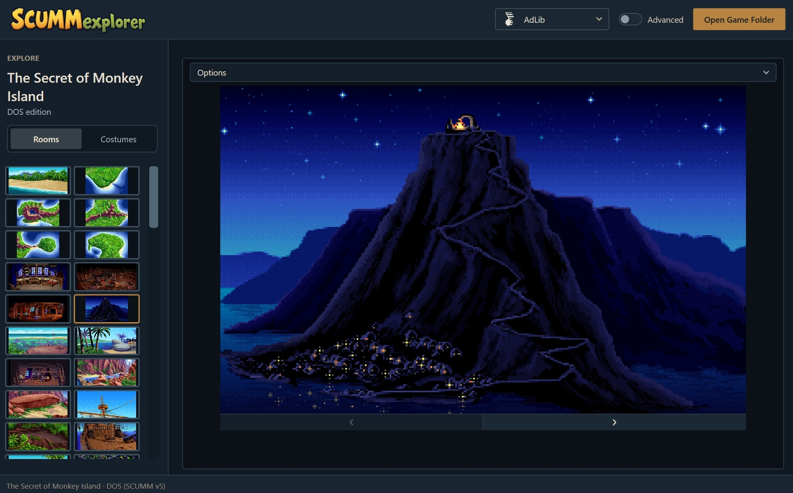
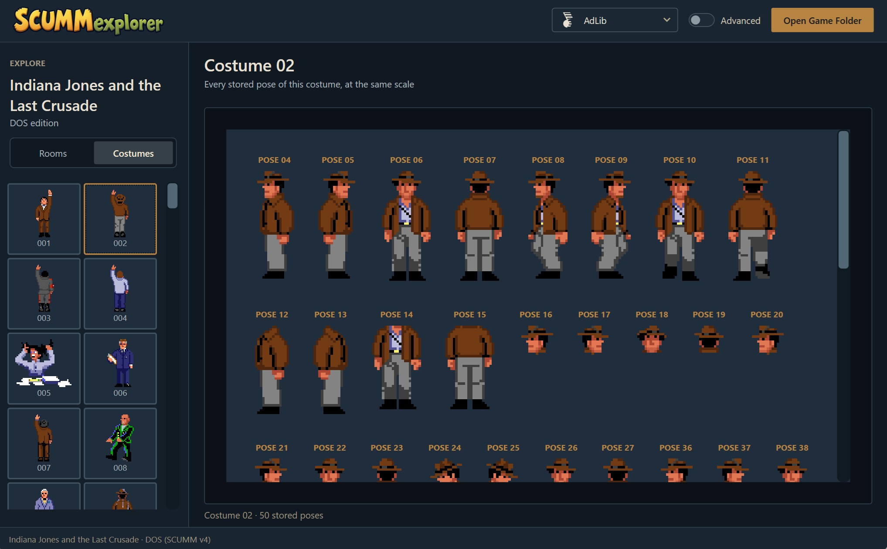
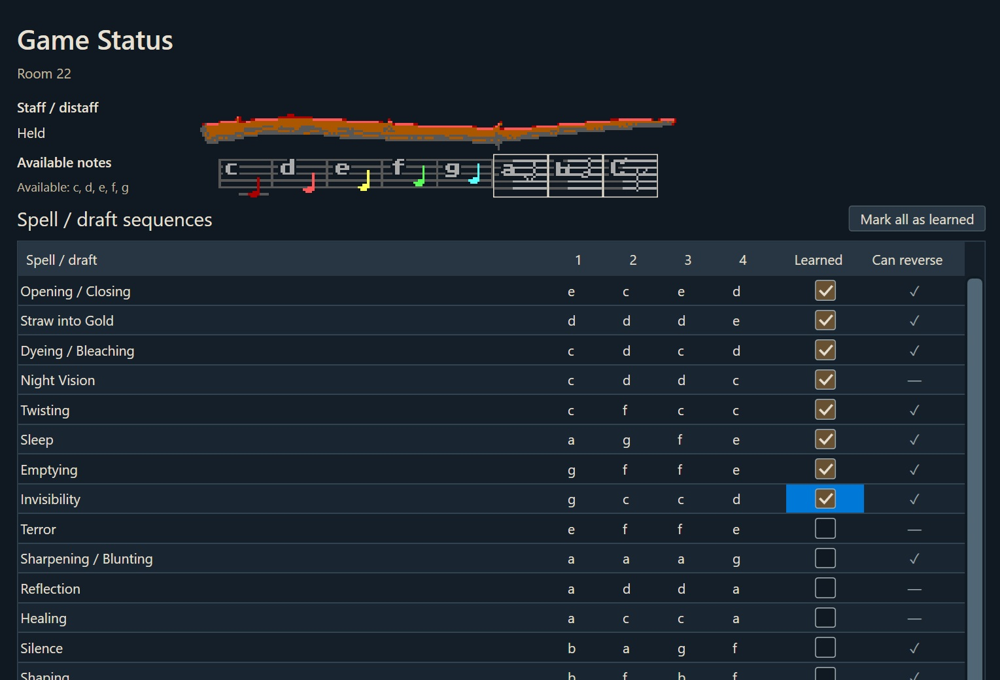
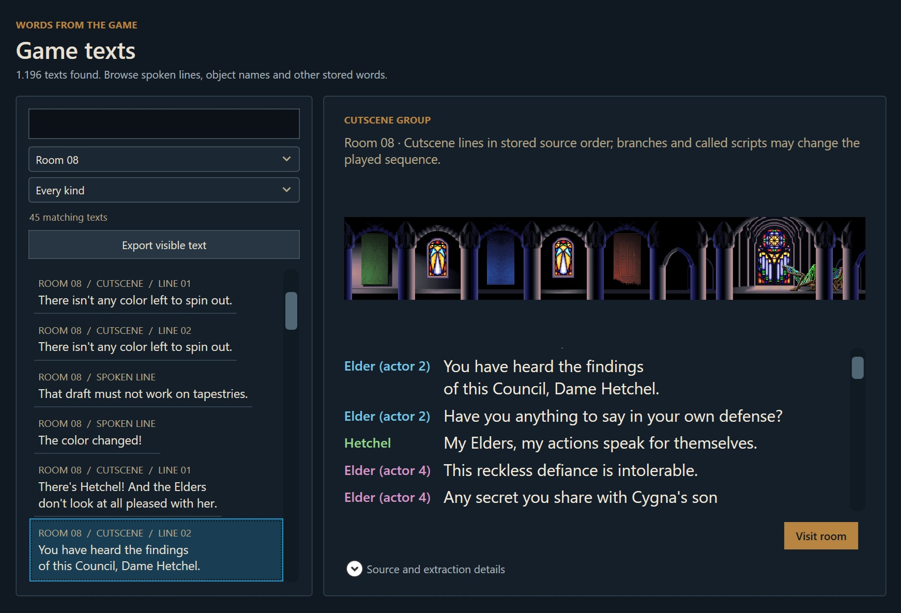
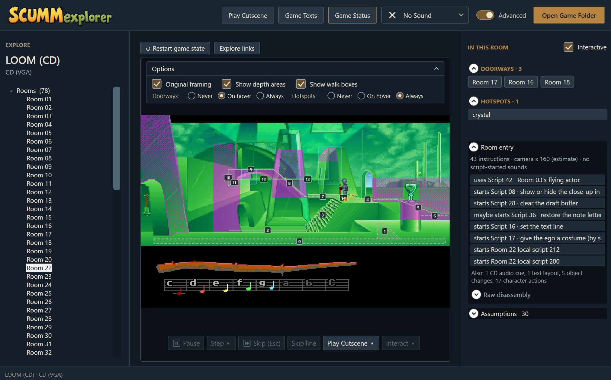
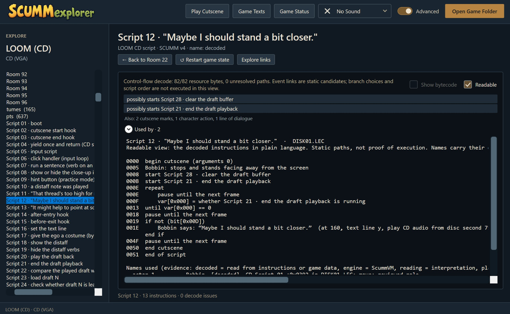

<p align="center">
  
</p>

*Remember the view from the lookout on Mêlée Island, the eerie halls of Maniac Mansion, or your first steps into LOOM's Guild of Glassmakers?*

SCUMMexplorer lets you wander the old SCUMM adventures from the inside. Revisit their room artwork, read the dialogue, and explore the scripts behind those memories. In LOOM, you can also click objects and exits, replay cutscenes, and hear the music; the other games currently offer browsing, with sound where supported. Everything is rebuilt live from **your own game files**. Nothing is included, nothing is copied.

<p align="center">
  <a href="screenshots/Rooms.jpg"></a>
  <br>
  <strong>Return to the places you remember.</strong><br>
  Browse The Secret of Monkey Island's rooms by their artwork.
</p>

<p align="center">
  <a href="screenshots/Costumes.jpg"></a>
  <br>
  <strong>Look closer at familiar faces.</strong><br>
  Explore the stored costume poses from Indiana Jones and the Last Crusade.
</p>

## Games

- **LOOM** (EGA, DOS), the main focus, in these editions:
  - English, with or without the Roland (MT-32) upgrade
  - Spanish, with or without the Roland upgrade, and version 1.2
  - French
  - German
  - Italian
  - the short and the long self-running demo
- **LOOM** (CD, VGA, English), from a folder, a `.cue`/`.bin` or an `.iso`, with the voices and music from the disc

Point the app at a game folder and it recognises the game and the edition from the files themselves, even if the executable is missing. Other classic SCUMM games open in a limited, browse-only way (no interaction, actors or cutscenes yet):

- **Indiana Jones and the Last Crusade** (EGA and 256 colours)
- **The Secret of Monkey Island** (VGA, EGA and CD)
- **Monkey Island 2: LeChuck's Revenge** (floppy, with the MT-32 and Sound Blaster releases, and talkie; English and Spanish)
- **Indiana Jones and the Fate of Atlantis** (floppy, talkie, CD)
- **Maniac Mansion** (classic and enhanced)
- **Zak McKracken and the Alien Mindbenders** (classic and enhanced)

In these games the room picker fills in on its own, the Costumes tab sits beside the Rooms tab (where costumes can be read), and sounds are in the Advanced tree.

### What each game supports

✔ works, ◐ partly (see the notes under the table), – not supported yet. This is what has been checked so far; most browse-only features have been verified against the game data and as pictures, not yet compared line by line with ScummVM.

| Game | Rooms | Objects | Walk boxes | Costumes | Sound | Texts | Scripts | Play | Cutscenes | Status |
|---|:-:|:-:|:-:|:-:|:-:|:-:|:-:|:-:|:-:|:-:|
| **LOOM** EGA English (reference) | ✔ | ✔ | ✔ | ✔ | ✔ | ✔ | ✔ | ✔ | ✔ | ✔ |
| **LOOM** EGA other editions | ✔ | ✔ | ✔ | ✔ | ✔ | ✔ | ✔ | ✔ | ◐ | ✔ |
| **LOOM** demos | ✔ | ✔ | ✔ | ✔ | ✔ | ✔ | ✔ | ✔ | ◐ | ✔ |
| **LOOM** CD | ✔ | ✔ | ✔ | ✔ | ✔ | ✔ | ✔ | ✔ | ◐ | ✔ |
| **Indiana Jones 3** EGA | ✔ | ◐ | ✔ | ✔ | ✔ | ✔ | ✔ | – | – | – |
| **Indiana Jones 3** 256 colours | ✔ | ◐ | ✔ | ✔ | ✔ | ✔ | ✔ | – | – | – |
| **Monkey Island 1** floppy | ✔ | ◐ | ✔ | ✔ | ✔ | ✔ | ✔ | – | – | – |
| **Monkey Island 1** CD | ✔ | ◐ | ✔ | ✔ | ◐ | ✔ | ✔ | – | – | – |
| **Monkey Island 2** | ✔ | ◐ | ✔ | ✔ | ◐ | ✔ | ✔ | – | – | – |
| **Indiana Jones 4** | ✔ | ◐ | ✔ | ✔ | ◐ | ✔ | ✔ | – | – | – |
| **Maniac Mansion** enhanced | ✔ | ◐ | ✔ | ✔ | ✔ | ✔ | ✔ | – | – | – |
| **Maniac Mansion** classic | ✔ | ◐ | ✔ | ◐ | ✔ | ✔ | ✔ | – | – | – |
| **Zak McKracken** enhanced | ✔ | ◐ | ✔ | ✔ | ✔ | ✔ | ✔ | – | – | – |
| **Zak McKracken** classic | ✔ | ◐ | ✔ | ◐ | ✔ | ✔ | ✔ | – | – | – |

<details>
<summary>Notes on the matrix</summary>

- **Columns.** *Rooms* shows the room pictures (LOOM in its first-visit state), *Texts* is the Game Texts browser, *Scripts* the raw and readable script views, *Play* clicking in a live room with actors and scripts, *Status* the Game Status editor.
- **LOOM editions.** "Other editions" are Spanish, plain English, French, German, v1.2 and Italian. "Demos" are the short and the long self-running demo.
- **Audio devices.** LOOM EGA: AdLib and PC speaker, plus Roland MT-32 when the Roland upgrade is installed. LOOM CD: voices and disc music. Monkey Island 2 and Indiana Jones 4: Roland MT-32 (needs your own MT-32 ROM images), AdLib and PC speaker. Other browse-only games: AdLib and PC speaker (Indiana Jones 3, Monkey Island 1 floppy) or PC speaker and PCjr/Tandy (Maniac Mansion, Zak McKracken).
- **Objects.** In the browse-only games, objects are painted only where the game data gives them a starting state (Maniac Mansion and Zak McKracken, Indiana Jones 3 EGA). The v4 and v5 games show an object's name when you hover over it; the objects themselves would need the room scripts to run first.
- **Walk boxes** (Advanced) are read for every game.
- **Costumes** are drawn in the palette of the room that stores them, so some look off (Guybrush's shirt). The classic Maniac Mansion and Zak McKracken use the explorer's estimate of the actor colours, because the scripts choose them.
- **Sounds.** AdLib music in the Monkey Island and Indiana Jones 3 (256 colours) disks plays at half tempo, set by ear, not from ScummVM's source. Indiana Jones 3 EGA plays its AdLib music at the LOOM tempo, which has not been checked by ear. Monkey Island 1 CD lists the disc's 24 audio tracks, each named after the room whose music it is and the sound that starts it (read from the game's own sounds; two tracks no sound starts stay unnamed). The Monkey Island 2 and Indiana Jones 4 music (iMUSE) plays on Roland MT-32, AdLib and PC speaker, and their sampled effects (Sound Blaster) play too; these were listened to and confirmed by the author, and songs wait at the first loop point instead of looping. The spoken lines of the talkie versions (`MONSTER.SOU`, also on the Indiana Jones 4 CD) play from Game Texts with "Play speech" on any line that has one. The PCjr/Tandy sounds of Maniac Mansion and Zak McKracken are ported from ScummVM but not yet listened to.
- **Cutscenes.** The demos play only their preview. LOOM English EGA has a hand-checked list of 328 scenes. Other LOOM editions and the CD derive theirs from the game's own scripts.
- The Maniac Mansion, Zak McKracken, Monkey Island, Indiana Jones and Atlantis columns marked "–" describe what the app does not read yet, not what the original game lacks. The detailed list is in [Requirements](docs/REQUIREMENTS.md) (section 3.1).

</details>

## Getting started

1. Build and run the app (Windows, .NET 10; see *Development* below).
2. Press **Open Game Folder** and choose a folder you own. The app reopens it next time.
3. Pick a room and explore.

## For everyone: just play with it

- **Choose a room by its picture.** Every room is shown as the game first showed it, with no gaps. Wide rooms scroll with the arrow keys.
- **Click the world.** Bobbin walks to what you click and uses it, exactly as the game's own scripts decide. Double-click to look at something. Exits lead on to the next room. The other characters are there too, walking and talking, and the room's own animations keep running.
- **Cast drafts.** Play the distaff with the keyboard or the mouse, as in the game.
- **Play a cutscene.** Any room with a scene offers **Play Cutscene**; pause it, skip it, or watch it through to the end.
- **Change the story.** **Game Status** lets you pick up the staff, set how many notes you know, learn any draft, and mark scenes as done or undone, then walk on from there.
- **Listen.** Music and effects through AdLib, PC Speaker or the Roland MT-32 (see below); the CD edition plays its voices and its disc music. The choice is remembered.
- **Look closer.** Show doorways and hotspots on hover, switch to the original framing or fill the window, or go full screen (F11).

<table>
  <tr>
    <td width="50%" valign="top" align="center">
      <a href="screenshots/LoomGameStatus.jpg"></a><br>
      <strong>Change what Bobbin knows.</strong><br>
      Choose available notes and learned drafts in Game Status.
    </td>
    <td width="50%" valign="top" align="center">
      <a href="screenshots/LoomGameTexts.jpg"></a><br>
      <strong>Rediscover the words.</strong><br>
      Browse LOOM's dialogue alongside the rooms it belongs to.
    </td>
  </tr>
</table>

## For the curious: Advanced mode

Switch **Advanced** on, and the explorer opens up. Everything here reads from the game's own data, and every guess is labelled as a guess.

<p align="center">
  <a href="screenshots/LoomAdvanced.jpg"></a>
  <br>
  <strong>See how a room works.</strong><br>
  LOOM CD with walk boxes, depth areas and the scripts behind the scene.
</p>

- **The whole game as a tree.** Rooms, costumes, scripts, sounds and music, and the game files, each with the names the community knows them by and where the name comes from.
- **Every script, two ways.** The decoded instructions, or a plain-language reading with names, conditions and branches written out. A "used by" index shows who calls what.
- **A cutscene picker for everything.** Search by title and filter by scenes, dialogue and reactions, or all playable. Each entry says how its start was set up, and anything the app had to assume is spelled out.
- **Game Texts.** Every spoken line, object name, verb label and dialogue menu, searchable, shown with the room's artwork. Read a conversation, visit its room, or play the cutscene it belongs to.
- **What just happened?** After each click: the game's reaction, a timeline of the scripts it ran, the raw trace, and the assumptions behind it.
- **Room inspection.** Doorway and hotspot lists, walk boxes, depth areas, the room's entry script, and an inspection mode where a click cycles an object's stored pictures without running any script.
- **Step and pause.** Advance a scene frame by frame.
- **Restart the story** from the very beginning in one click.
- **A sound player for every sound.** Play any music or effect on demand, with an AdLib level slider and the room's music cues. On the CD edition, browse every voice and music track on the disc.
- **Game Status in depth.** The raw story bits, where each value comes from, and every draft with its notes, flags and reversing.

<p align="center">
  <a href="screenshots/LoomReadableScripts.jpg"></a>
  <br>
  <strong>Read the logic behind a familiar line.</strong><br>
  The game's own script, decoded into plain language with links to related scripts.
</p>

## Roland MT-32 music (optional)

Choose **Roland MT-32** in the sound menu to hear the LOOM Roland upgrade's music, including the overture that only plays on this card. It needs two things that are not part of this program:

1. **A game folder with the Roland upgrade installed** (it has `82.LFL` to `85.LFL`).
2. **Your own MT-32 ROM images**, in one folder: `MT32_CONTROL.ROM` and `MT32_PCM.ROM`, or `CM32L_CONTROL.ROM` and `CM32L_PCM.ROM`. They are copyrighted and never shipped.

The app looks for that folder in this order: the `SCUMM_MT32_ROM_ROOT` environment variable, the folder you chose last time, then a folder named `mt32` beside the game folder. If it finds none it asks once and remembers.

## Development

Windows WPF application targeting .NET 10. Build from the repository root; the app is compiled into **`Exe/Debug/`** (or **`Exe/Release/`** with `-c Release`).

```powershell
dotnet build SCUMMexplorer.slnx
dotnet test tests/SCUMMexplorer.Tests/SCUMMexplorer.Tests.csproj --no-build
```

| Document | Purpose |
|---|---|
| [Requirements](docs/REQUIREMENTS.md) | What the app must do |
| [SCUMM script reference](docs/engine/SCUMM_SCRIPT_MAP.md) | Version-specific engine variables and script behavior |
| [LOOM script map](docs/loom/LOOM_SCRIPT_MAP.md) | Game-specific scripts, variables, verbs and rooms, with edition scope |
| [Research](docs/engine/RESEARCH.md) | Technical references |

## License

SCUMMexplorer is licensed under the GNU General Public License, version 3 or later (see [LICENSE](LICENSE)). It adapts parts of ScummVM, which is GPL; game files and ROM images are never included.

## Audio and third-party notices

AdLib uses [NukedOPL3Sharp](https://www.nuget.org/packages/NukedOPL3Sharp/) (LGPL 2.1). The Roland MT-32 uses [Munt](https://github.com/munt/munt) (`mt32emu`, LGPL-2.1-or-later) through [Mt32emu.net](https://github.com/gregdivis/mt32emu.net). See [third-party audio notices](THIRD_PARTY_NOTICES.md).
